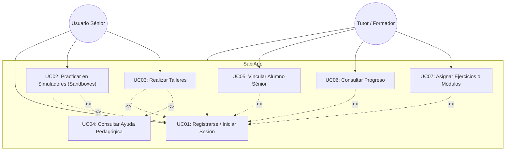

Diagrama de Casos de Uso - SabiApp

Prototipos de Interfaz de Usuario
Este es un prototipo de la pantalla del usuario senior, especificamente el apartado del banco 
┌────────────────────────────────────────────────────────┐
│      SABIAPP                     [  Ayuda / Glosario ] │
├────────────────────────────────────────────────────────┤
│                                                        │
│   ENTORNO DE PRÁCTICA SEGURO                           │
│   (Sus cuentas y dinero real NO corren ningún riesgo)  │
│                                                        │
│  ────────────────────────────────────────────────────  │
│                                                        │
│  PASO 1 DE 3: Elija a quién enviar el dinero           │
│                                                        │
│  ┌──────────────────────────────────────────────────┐  │
│  │     María (Hija)                 612 345 678     │  │
│  └──────────────────────────────────────────────────┘  │
│  ┌──────────────────────────────────────────────────┐  │
│  │     Juan (Nieto)                 699 887 766     │  │
│  └──────────────────────────────────────────────────┘  │
│  ┌──────────────────────────────────────────────────┐  │
│  │     Escribir un número nuevo                     │  │
│  └──────────────────────────────────────────────────┘  │
│                                                        │
│  ────────────────────────────────────────────────────  │
│                                                        │
│  ┌────────────────────────┐  ┌──────────────────────┐  │
│  │  ⬅️ VOLVER AL MENÚ     │  │  CONTINUAR ➡️        │  │
│  │                         │  │                      │  │
│  └────────────────────────┘  └──────────────────────┘  │
│                                                        │
└────────────────────────────────────────────────────────┘

Este es un prototipo de la pantalla del usuario senior, especificamente el apartado del anti fraude. 

┌────────────────────────────────────────────────────────┐
│  🟢 SABIAPP - APRENDE A DETECTAR FRAUDES               │
├────────────────────────────────────────────────────────┤
│                                                        │
│    Ha recibido el siguiente mensaje SMS en su móvil:   │
│                                                        │
│  ┌──────────────────────────────────────────────────┐  │
│  │    De: +34 600 000 999                           │  │
│  │                                                  │  │
│  │ "CORREOS: Su paquete no se ha podido entregar   │  │
│  │  por faltar el n° de calle. Pague 1,89€ aquí:    │  │
│  │  http://correos-entrega-incidencia.com/pago"     │  │
│  └──────────────────────────────────────────────────┘  │
│                                                        │
│  ¿Qué debe hacer con este mensaje?                     │
│                                                        │
│  ┌──────────────────────────────────────────────────┐  │
│  │     1. Pulsar el enlace para pagar los 1,89€     │  │
│  └──────────────────────────────────────────────────┘  │
│  ┌──────────────────────────────────────────────────┐  │
│  │    2. Borrar el mensaje y NO pulsar en el enlace │  │
│  └──────────────────────────────────────────────────┘  │
│                                                        │
│  💡 [ Pista: Mire atentamente la dirección web (URL) ] │
│                                                        │
└────────────────────────────────────────────────────────┘

Este es un prototipo de la pantalla del usuario tutor.

┌────────────────────────────────────────────────────────────────────────┐
│  SABIAPP - PANEL DEL TUTOR                  [ Mi Cuenta (Tutor) ]   │
├────────────────────────────────────────────────────────────────────────┤
│                                                                        │
│Familiar supervisado:  [ Carmen Mendoza (72 años)  ▼ ]  [ + Vincular ]  │
│                                                                        │
│  ┌───────────────────────┐ ┌───────────────────────┐ ┌───────────────┐ │
│  │ Módulos Completados   │ │ Tasa de Aciertos      │ │ Dificultad    │ │
│  │      6 de 8           │ │        85%            │ │ Pantalla      │ │
│  └───────────────────────┘ └───────────────────────┘ └───────────────┘ │
│                                                                        │
│  Detalle de Rendimiento y Bloqueos Recientes:                          │
│  ┌───────────────────────────┬─────────────┬─────────────────────────┐ │
│  │ Módulo de Simulación      │ Estado      │ Puntos de Atasco/Error  │ │
│  ├───────────────────────────┼─────────────┼─────────────────────────┤ │
│  │ Cita Médica (Salud)       │ Superado    │ Ninguno (Fluido)        │ │
│  │ Bizum Ficticio (Banca)    │ En progreso │ Duda al introducir PIN  │ │
│  │ Taller SMS (Ciberestafas) │ Superado    │ Requirió 2 intentos     │ │
│  └───────────────────────────┴─────────────┴─────────────────────────┘ │
│                                                                        │
│  Recomendaciones de la aplicación:                                     │
│  "Carmen tiene dificultades para diferenciar el botón de 'Confirmar'   │
│   del botón de 'Cancelar' en operaciones bancarias. Se sugiere         │
│   reforzar esa lección juntos."                                        │
│                                                                        │
└────────────────────────────────────────────────────────────────────────┘
