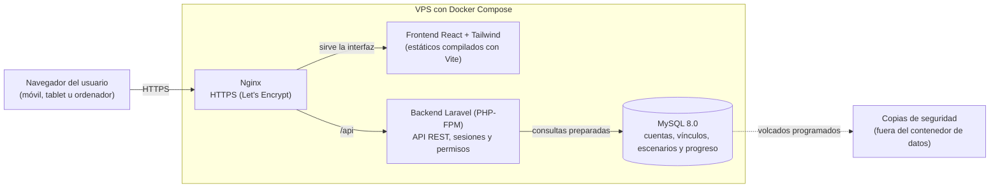

# 3.1 Planteamiento de Necesidades y Soluciones: SabiApp

- **Módulo:** Proyecto Intermodular (2.º DAW) · **Fase:** Sprints 1 a 3 de la actividad (documento consolidado)
- **Equipo:** Minority Report (Juan Manuel Francisco Mendoza, Bakunin Sosa Álvarez, Irene Pascual Moreno) · **Fecha:** Noviembre 2026

> «Sprint 1–3» son los sprints semanales de la actividad; **SD1–SD3** son los futuros Sprints de desarrollo del producto.

---

## Índice del documento

1. [Planteamiento del problema y necesidades detectadas](#1-planteamiento-del-problema-y-necesidades-detectadas) (diagnóstico, contexto, límites de la evidencia y público objetivo)
2. [Análisis de alternativas y propuesta de solución](#2-análisis-de-alternativas-y-propuesta-de-solución) (comparativa A/B/C con criterios ponderados, estructura modular y articulación)
3. [Aspectos innovadores y análisis comparativo](#3-aspectos-innovadores-y-análisis-comparativo) (_benchmarking_, matriz de mercado y factores diferenciales)
4. [Viabilidad técnica, recursos y organización](#4-viabilidad-técnica-recursos-y-organización) (arquitectura, infraestructura, competencias, roles, esfuerzo y riesgos)
5. [Documentación de diseño y prototipado](#5-documentación-de-diseño-y-prototipado) (arquitectura, esquema funcional, wireframes y métricas)
6. [Presupuesto económico y plan de financiación](#6-presupuesto-económico-y-plan-de-financiación) (costes directos, IA y automatización, horas de equipo, financiación y recuperación del desembolso)
7. [Metodología ágil, Epics y Definition of Done (DoD)](#7-metodología-ágil-epics-y-definition-of-done-dod) (Scrum, Epics EP-01 a EP-08, historias US-01 a US-52, DoD y protocolo de validación)
8. [Conclusiones y hoja de ruta](#8-conclusiones-y-hoja-de-ruta) (alcance del MVP, impacto social, próximos pasos, feedback y decisiones pendientes)
9. [Fuentes de información, referencias normativas y mercado](#9-fuentes-de-información-referencias-normativas-y-mercado) (referencias en formato APA 7)

---

## 1. Planteamiento del problema y necesidades detectadas

**Problema.** La digitalización de la salud, la banca, la administración y la paquetería convierte el smartphone en un canal cada vez más habitual. Para parte de los mayores de 55 años el obstáculo no es tener móvil, sino la **falta de seguridad operativa y el miedo al error irreversible**. Se traduce en tres problemas: parálisis ante el posible fallo, dependencia de familiares o cuidadores, y vulnerabilidad ante _phishing_ y _smishing_.

**Hipótesis de partida:** practicar con datos ficticios, con ayuda contextual y repitiendo sin penalización aumenta la confianza. Se validará con usuarios y no se presenta como efecto ya demostrado. SabiApp no sustituye la ayuda presencial, la complementa.

**Evidencia y urgencia.**

- El 96,3 % de las personas de 16 a 74 años usó internet en los últimos tres meses y el 80,7 % contactó con las administraciones por internet en el último año (INE, 2025). Los trámites ya son digitales por defecto.
- El uso de IA generativa baja del 19,2 % (55–64 años) al 7,4 % (65–74) (INE, 2025): la brecha aparece con cada tecnología nueva. Es un indicador de adopción, no de capacidad.
- El Banco de España documenta el cierre continuado de oficinas y cajeros (Banco de España, 2025), e INCIBE gestionó 122.223 incidentes en 2025, un 26 % más (INCIBE, 2026; cifra de toda la población).
- **Límite:** los datos del INE llegan hasta los 74 años. Antes de cerrar el diseño habrá entrevistas y pruebas breves con mayores.
- **Urgencia:** los canales presenciales se reducen y el fraude crece. Cada año sin capacitación práctica aumenta la exposición del colectivo sénior.

| Perfil                                  | Necesidad                                                   | Relación con SabiApp                              |
| :-------------------------------------- | :---------------------------------------------------------- | :------------------------------------------------ |
| Mayores de 55 años                      | Practicar sin consecuencias reales y con ayuda comprensible | Usuario principal (no se recoge su edad exacta)   |
| Familias y tutores (35–55 años)         | Acompañar sin ser soporte técnico permanente                | Tutor, solo con invitación aceptada por el alumno |
| Centros de mayores y servicios sociales | Talleres con métricas de participantes autorizados          | Colaborador del piloto y cliente futuro           |

---

## 2. Análisis de alternativas y propuesta de solución

- **A. Talleres presenciales con guías:** trato humano y adaptación inmediata; requiere formadores y espacio, y la práctica no continúa en casa.
- **B. Dispositivo simplificado (modelo Bleta; ONCE):** entorno controlado; exige comprar o ceder equipos y puede diferir del móvil habitual.
- **C. SabiApp, plataforma web de simulación (_sandbox_):** repetición con datos ficticios, acceso desde el navegador y seguimiento autorizado; exige desarrollo y mantenimiento de contenidos.

A y B no se descartan por inútiles y A puede combinarse con C. Puntuación de 1 a 5, con pesos y valores que son estimaciones del equipo pendientes de validar con centros y usuarios:

| Criterio (peso)                                 |    A     |    B     |    C     |
| :---------------------------------------------- | :------: | :------: | :------: |
| Coste para usuario o centro (20 %)              |    2     |    1     |    5     |
| Práctica real sin riesgo (30 %)                 |    2     |    3     |    5     |
| Escalabilidad y alcance (20 %)                  |    1     |    2     |    5     |
| Viabilidad para el equipo en 6–9 semanas (15 %) |    3     |    1     |    3     |
| Aceptación esperada (15 %)                      |    4     |    2     |    4     |
| **Total ponderado (sobre 5)**                   | **2,25** | **1,95** | **4,55** |

**Decisión: C.** Su punto débil es la viabilidad, por lo que el MVP se acota (ver 8). **Reserva:** si el feedback descartara C, se mantendría A reforzada con ejercicios de SabiApp en los propios talleres.

**Módulos e integración.** Los simuladores y el taller generan el progreso; el módulo de interfaz y tutores lo guarda en MySQL a través de la API y se lo muestra solo al tutor autorizado. Los módulos no acceden directamente a la base de datos.

| Módulo                                | Función                                                                                                          |     Fase      |
| :------------------------------------ | :--------------------------------------------------------------------------------------------------------------- | :-----------: |
| 1. Simuladores (_sandbox_)            | Cita médica en 4 pasos; después, banca y Bizum simulado en 3 pasos. Datos 100 % ficticios.                       |  Cita en MVP  |
| 2. Taller de ciberestafas             | 4 escenarios (2 SMS y 2 correos) con explicación obligatoria de las pistas del fraude.                           |      MVP      |
| 3. WhatsApp con microaprendizajes     | 8 lecciones de 3–5 min en tres niveles, sin permisos reales de cámara, micrófono ni galería.                     |    Después    |
| 4. Interfaz sénior y panel de tutores | _Lexend_ ≥ 18 px, contraste ≥ 4,5:1, botones ≥ 48 px; seguimiento de actividades, acierto inicial y último paso. | Básico en MVP |

---

## 3. Aspectos innovadores y análisis comparativo

La comparación es exploratoria: antes de defender una ventaja competitiva se revisarán funciones y precios actuales de cada alternativa.

| Referencia                                 | Qué aporta                              | Diferencia de SabiApp                                        |
| :----------------------------------------- | :-------------------------------------- | :----------------------------------------------------------- |
| Lumosity y CogniFit (Lumos Labs; CogniFit) | Ejercicios cognitivos con seguimiento   | Se centra en trámites reales, no en entrenamiento cognitivo. |
| Duolingo                                   | Lecciones breves con progresión y vidas | Repetición sin penalización aplicada a gestiones digitales.  |
| Bleta (ONCE)                               | Tablet adaptada para mayores            | Web sobre el móvil que ya tienen.                            |
| Canal Sénior (Ministerio del Interior)     | Clases online y formación antiestafas   | Añade práctica simulada e individual.                        |

**Diferenciadores:**

1. **Tecnología:** _sandbox_ sin conexión con servicios bancarios, sanitarios ni de mensajería reales.
2. **Diseño:** UX sénior nativa (_Lexend_, áreas táctiles ≥ 48 px, castellano llano).
3. **Metodología:** microlecciones de 3–5 min con refuerzo positivo, sin vidas ni cuentas atrás.
4. **Modelo de negocio:** _freemium_ con acceso básico gratuito, suscripción familiar (5 €/mes) y licencia de centro (100 €/mes).
5. **Privacidad:** el tutor solo ve el progreso de quien acepta su invitación, y el alumno puede revocarla.

Se validarán con pruebas de comprensión, autonomía y disposición de los centros.

---

## 4. Viabilidad técnica, recursos y organización

### 4.1 Pila tecnológica

Frontend React que consume la API REST de Laravel, sobre MySQL y contenerizado con Docker (diagrama en 5). Documentación de referencia: Laravel, React, Tailwind CSS, Docker, MySQL y PHP (ver 9).

| Tecnología                               |    Estado     | Uso                                                                                        |
| :--------------------------------------- | :-----------: | :----------------------------------------------------------------------------------------- |
| HTML5, CSS3, JS ES6+, PHP 8.x, MySQL 8.0 |     Base      | Aplicación web y persistencia relacional.                                                  |
| **Laravel**                              | Por confirmar | API, roles por _middleware_, migraciones, CSRF integrado, Argon2id y consultas preparadas. |
| **React**                                | Por confirmar | Componentes y máquinas de estado de los simuladores; compilado con Vite.                   |
| **Tailwind CSS**                         | Por confirmar | Reglas de diseño sénior centralizadas y CSS final ligero.                                  |
| Docker Compose                           |     Base      | Entorno idéntico en los 3 equipos (Nginx, PHP-FPM, MySQL; Node solo compila).              |
| Git/GitHub, Figma, Lighthouse, WAVE, axe |     Base      | Versiones y revisión cruzada, diseño y auditoría de accesibilidad.                         |

Laravel, React y Tailwind los propuso Sergio Montes (stakeholder). Si no se aprueban, se mantiene la pila base y se actualizan arquitectura, esfuerzo y criterios antes de empezar; cambiar de tecnología no tiene coste cero.

### 4.2 Recursos

- **Materiales:** 3 portátiles propios, 1 smartphone Android básico (≈ 150 €) y 1 tablet (≈ 160 €) para probar ergonomía y rendimiento reales.
- **Infraestructura:** entorno local en Docker y un VPS con HTTPS (Let's Encrypt), dominio `.es` y copias de la base de datos (`mysqldump`) fuera del contenedor.
- **Servicio de correo** (recuperar contraseña e invitaciones): proveedor por seleccionar, con nivel gratuito si cubre el piloto.
- **Externos:** proveedores (OVHcloud, VPS, MOO), un centro colaborador por confirmar y el stakeholder docente (Sergio Montes). Sin subcontrataciones.

### 4.3 Equipo y competencias

Los tres forman el equipo de desarrollo y los roles técnicos no son exclusivos. _Scrum Master_ y _Product Owner_ **rotan entre los tres en cada Sprint**.

| Miembro                           | Responsabilidad principal                                                                                          | Apoyo y competencias                                                                             |
| :-------------------------------- | :----------------------------------------------------------------------------------------------------------------- | :----------------------------------------------------------------------------------------------- |
| **Irene Pascual Moreno**          | Backend: API Laravel/PHP, sesiones, permisos por rol y por vínculo. También actas, y contabilidad con Juan Manuel. | Apoya seguimiento e interfaz del taller. React: experiencia parcial (React Native y TypeScript). |
| **Bakunin Sosa Álvarez**          | MySQL, migraciones, Docker, VPS, copias y gobernanza de Git. También compras.                                      | Apoya integración y pruebas de recuperación.                                                     |
| **Juan Manuel Francisco Mendoza** | Frontend, UX y accesibilidad: React, Tailwind, Figma, WCAG 2.2. También centros piloto y marketing.                | Apoya el flujo de cita médica y las pruebas.                                                     |

Base del ciclo: HTML, CSS, JS, PHP, MySQL, Git y Docker. **Formación interna en SD1:** Laravel, React y Tailwind; accesibilidad; seguridad (OWASP); y pruebas de usabilidad con mayores. La captación, las pruebas y la documentación se reparten entre los tres.

### 4.4 Esfuerzo

3 personas × 9 h/semana × 6–9 semanas = **162–243 h**. Con 162 h para las **33 historias del MVP** salen 4,9 h por historia (7,4 h con 243 h). Reparto inicial, a refinar tras un ensayo técnico: formación y ensayo 12 h · EP-07 20 · EP-01 y vinculación 24 · EP-06 y EP-02 30 · EP-04 18 · EP-05 básico 14 · pruebas y documentación 24 · reserva 20 = **162 h**. Si el ensayo invalida estas cifras, se reduce funcionalidad antes que calidad.

### 4.5 Riesgos y mitigación

| Riesgo                                            | Impacto | Mitigación                                                                                                                                                                                                                                                                              |
| :------------------------------------------------ | :-----: | :-------------------------------------------------------------------------------------------------------------------------------------------------------------------------------------------------------------------------------------------------------------------------------------- |
| Barreras sensoriales y motoras                    |  Alto   | Botones ≥ 48 px, contraste ≥ 4,5:1, teclado y máximo 4 pasos por trámite.                                                                                                                                                                                                               |
| Privacidad (RGPD) y acceso indebido al progreso   |  Alto   | Solo datos ficticios en simuladores; sin edad exacta; únicos datos reales: nombre, correo y progreso. Vínculo aceptado y revocable, con permisos por recurso en servidor. _Facilita RGPD_ es ayuda inicial, no acredita cumplimiento (AEPD); la base jurídica se fija antes del piloto. |
| Pérdida de datos                                  |  Alto   | Copias fuera del contenedor y restauración probada.                                                                                                                                                                                                                                     |
| Falta de participantes                            |  Alto   | Confirmar el centro antes de programar sesiones.                                                                                                                                                                                                                                        |
| Plazos ajustados y curva de aprendizaje del stack |  Medio  | MVP acotado, formación, ensayo técnico en SD1 y convenciones estándar.                                                                                                                                                                                                                  |
| Dispositivos antiguos y redes lentas              |  Medio  | Vite, carga diferida, WebP y medición con 4G simulada.                                                                                                                                                                                                                                  |
| IA y automatización del equipo                    |  Medio  | Solo como herramienta interna, nunca con datos de usuarios; presupuesto cerrado y revisión tras el primer mes.                                                                                                                                                                          |

---

## 5. Documentación de diseño y prototipado

### 5.1 Arquitectura



**Flujo:** Nginx sirve la interfaz React por HTTPS. Los simuladores corren en el cliente como máquinas de estado y llaman a la API solo para iniciar sesión, cargar escenarios y guardar el progreso. Laravel valida identidad, permisos y datos antes de tocar MySQL. El tutor consulta el progreso por la misma API. **Vinculación:** el tutor invita por correo, el alumno acepta o rechaza y puede revocar cuando quiera. Antes de aceptar no se comparte nada.

### 5.2 Wireframes

**Cita médica (MVP).** Flujo: centro → servicio → fecha y hora → resumen y confirmación. Todo es ficticio y salir no crea ninguna cita.

```text
┌────────────────────────────────────────────────────────┐
│ SABIAPP                                    [?] Ayuda   │
├────────────────────────────────────────────────────────┤
│   [!] PRÁCTICA: no se solicitará ninguna cita real     │
├────────────────────────────────────────────────────────┤
│  PASO 1 DE 4: Elija un centro (ficticio)               │
│  ( ) Centro de práctica Norte                          │
│  ( ) Centro de práctica Sur                            │
│                                                        │
├────────────────────────────────────────────────────────┤
│  [<-] SALIR DE LA PRÁCTICA             CONTINUAR [->]  │
└────────────────────────────────────────────────────────┘
```

**Antifraude (MVP).** Flujo: responder → explicación de los indicios → continuar o repetir. Se aceptan las opciones 2 y 3; las respuestas no se revelan antes de contestar y los enlaces no son navegables.

```text
┌────────────────────────────────────────────────────────┐
│ SABIAPP - APRENDE A DETECTAR FRAUDES                   │
├────────────────────────────────────────────────────────┤
│  [SMS] De: número desconocido                          │
│  "Su paquete está retenido. Pague 1,89 EUR aquí:       │
│   https://paquete-ejemplo.invalid"                     │
├────────────────────────────────────────────────────────┤
│  ¿Qué haría con este mensaje? Elija una opción:        │
│  [ ] 1. Abrir el enlace para pagar                     │
│  [ ] 2. No abrirlo y verificar por el canal oficial    │
│  [ ] 3. No abrirlo y bloquear al remitente             │
│  [?] Ver pista                                         │
└────────────────────────────────────────────────────────┘
```

**Seguimiento del tutor (MVP).** Flujo: el tutor elige un alumno con vínculo activo y ve finalizaciones, acierto inicial y último paso. Los bloqueos frecuentes y las recomendaciones llegan después.

```text
┌────────────────────────────────────────────────────────────────┐
│ SABIAPP - SEGUIMIENTO                      [ Invitar alumno ]  │
├────────────────────────────────────────────────────────────────┤
│  Alumno vinculado: [ Carmen v ]            [ Desvincular ]     │
│  [ Completadas: 2 de 5 ]  [ Acierto inicial: 50 % ]            │
├────────────────────────────────────────────────────────────────┤
│  Cita médica ........ En curso (último paso: 3 de 4)           │
│  Antifraude SMS 1 ... Completado | 1.ª respuesta correcta      │
│  Antifraude SMS 2 ... Completado | 1.ª respuesta incorrecta    │
│  Antifraude correo 1  Pendiente                                │
│  Antifraude correo 2  Pendiente                                │
├────────────────────────────────────────────────────────────────┤
│  [Ver actividad]                                               │
└────────────────────────────────────────────────────────────────┘
```

### 5.3 Métricas

**Intento:** sesión iniciada por el alumno. **Finalización:** último paso confirmado, o respuesta seguida de la explicación. **Abandono explícito:** salida voluntaria; cerrar el navegador no cuenta. **Acierto inicial:** primera respuesta correcta de un escenario. **Avance:** actividades completadas / 5 × 100 (1 cita + 4 escenarios). Los reintentos no alteran la primera respuesta.

---

## 6. Presupuesto económico y plan de financiación

Desembolso total: **1.110,84 €** (≈ 370 € por miembro). Horizonte: desarrollo del MVP y 12 meses de servicio, IVA incluido. Son reservas de planificación, no ofertas.

| Categoría                        | Cálculo                                                                         |          Coste |
| :------------------------------- | :------------------------------------------------------------------------------ | -------------: |
| Equipamiento de pruebas          | Smartphone 150 € + tablet 160 €                                                 |       310,00 € |
| Pruebas con mayores              | Material fungible 25 € + merienda (10 × 4 €) 40 €                               |        65,00 € |
| Infraestructura                  | VPS con copias (12 × 10 €) 120 € + dominio `.es` 7,25 €                         |       127,25 € |
| IA y automatización (cancelable) | 3 personas × 18 €/mes × 3 meses = 162 € + Make (9 € × 3) 27 €                   |       189,00 € |
| Marketing                        | 500 flyers A5 84,70 € + Meta Ads (3 × 50 €) 150 € + visitas (10 × 4 €) 40 €     |       274,70 € |
| Software                         | Laravel, React, Tailwind, Docker, Git, Figma Education, Copilot Student, Canva… |         0,00 € |
| **Subtotal**                     |                                                                                 |   **965,95 €** |
| Contingencia 15 %                | Hosting, publicidad, tarifas de suscripciones y correo                          |       144,89 € |
| **TOTAL**                        |                                                                                 | **1.110,84 €** |

- **Escenario mínimo ≈ 537 € (≈ 179 € por miembro):** dispositivos cedidos por un centro (−310 €) y solo herramientas gratuitas (−189 €), con la contingencia recalculada.
- **IA y automatización:** son herramientas internas (la v1 descarta IA generativa), y se paga solo lo que ahorre tiempo. Nunca reciben datos de usuarios.
- **Marketing:** lo lleva Juan Manuel. Los anuncios (≈ 250 clics; CPC medio de Facebook ≈ 0,63 $, sin dato para España) validan el mensaje, y la captación principal es directa en centros.
- **Trabajo no desembolsado:** 162–243 h × 15 €/h (tarifa supuesta) = 2.430–3.645 €. Con el desembolso: 3.540,84–4.755,84 €.
- **Financiación:** el MVP se autofinancia a partes iguales, sin deuda ni inversores. Compras, Bakunin; contabilidad, Irene y Juan Manuel. El apoyo en especie de centros no cuenta hasta acordarse. Después del MVP, _freemium_ con suscripción de 5 €/mes y licencia de centro de 100 €/mes, ambas por validar.
- **Recuperación del desembolso** (Stripe 1,5 % + 0,25 €; Stripe): un centro durante un año deja 1.179 € netos (margen ≈ 68 €) y una familia, 56,10 €, así que bastan ≈ 20 suscriptores. Es recuperación de caja, no punto de equilibrio empresarial: no incluye trabajo, impuestos, soporte ni mantenimiento. Costes recurrentes tras el MVP: 128,46 €/año (VPS y dominio). El escenario del pitch (200 suscripciones + 10 centros = 24.000 €/año) es solo una hipótesis.

Precios consultados en noviembre de 2026 (OVHcloud, MOO, Xataka, Lenovo, VPS Benchmarks, Influee, Javadex, GitHub Education, Virtua Cloud). Son estimaciones propias el fungible, la merienda, el VPS (10 €/mes), las visitas, los 3 meses de anuncios, los 18 €/mes de IA y los 15 €/h.

---

## Metodología ágil, Epics y Definition of Done (DoD)

Scrum en 3 Sprints de desarrollo (SD1–SD3) de 2–3 semanas, con tablero Kanban y acta de revisión por Sprint. El detalle de las 52 historias de usuario (US-01 a US-52) y sus criterios de aceptación está en el documento 3.2.

| Epic                                | Prioridad y Sprint          |      Historias      | DoD específico (medible)                                                                                        |
| :---------------------------------- | :-------------------------- | :-----------------: | :-------------------------------------------------------------------------------------------------------------- |
| **EP-01** Acceso y registro         | MVP · SD2                   |     US-01 a 05      | Argon2id; login < 2 s; recuperación con enlace de un solo uso y 30 min; 403 por rol.                            |
| **EP-02** Cita médica               | MVP · SD2–3                 |     US-06 a 11      | Máx. 4 pasos con resumen; datos 100 % ficticios; transiciones < 1 s; finalización y salida registradas.         |
| **EP-03** Bizum y banca             | Después del MVP             |     US-12 a 17      | Cero conexiones bancarias reales; Bizum en 3 pasos validado.                                                    |
| **EP-04** Antifraude                | MVP · SD3                   |     US-18 a 23      | 4 escenarios en BD (2 SMS y 2 correos); explicación siempre visible; enlaces no navegables; tolera microcortes. |
| **EP-05** Seguimiento y vinculación | MVP · SD2–3 (US-26 después) | US-24 a 28, 51 y 52 | Nada visible sin vínculo aceptado; revocación efectiva; métricas según 5.3.                                     |
| **EP-06** UX sénior                 | MVP · SD1–2                 |     US-29 a 33      | _Lexend_ ≥ 18 px, contraste ≥ 4,5:1, objetivos ≥ 48 px, 200 % de zoom, 0 errores críticos en WAVE/axe.          |
| **EP-07** DevOps                    | MVP · SD1–2                 |     US-34 a 38      | `docker compose up` en los 3 equipos, HTTPS con 301, sin secretos en el repo, restauración de copia probada.    |
| **EP-08** WhatsApp                  | Después del MVP             |     US-39 a 50      | 8 lecciones ≤ 5 min con desbloqueo progresivo, sin permisos reales.                                             |

**DoD global** (para toda tarea, historia o Epic):

1. Compila, incluido el frontend, y se ejecuta sin errores en Docker. Se integra en `develop` y de ahí a `main` solo mediante Pull Request aprobada por otra persona. Sin secretos y con el linter limpio.
2. Criterios de aceptación verificados con pruebas manuales documentadas, sin regresiones y con errores claros para mayores (nunca trazas del servidor).
3. Accesibilidad: sin errores críticos en WAVE/axe, teclado y foco visibles, contraste ≥ 4,5:1 y redistribución a 320 px. Los 18 px y 48 × 48 px son objetivos propios, más exigentes que el mínimo de WCAG 2.2 AA (24 px; W3C, 2024). Las auditorías automáticas no acreditan conformidad por sí solas.
4. Seguridad: consultas preparadas (PDO/Eloquent), CSRF en formularios y permisos por sesión, rol y vínculo en el servidor.
5. Tarea en _Done_, rama eliminada, documentación al día e incremento listo para la demo del Sprint.

**Protocolo de validación.**

- **Rendimiento:** mediana de 5 cargas en el smartphone de pruebas con 4G limitada (objetivo ≤ 3 s) y de 5 transiciones del simulador (≤ 1 s).
- **Red:** un microcorte durante una práctica no debe perder el estado ni duplicar resultados.
- **Usabilidad:** hasta 10 participantes; objetivo ≥ 80 % completa la cita sin que el facilitador toque el dispositivo. Es un umbral para iterar, no una prueba estadística.
- **Accesibilidad:** además de las auditorías automáticas, prueba manual con teclado y lector de pantalla.

---

## 8. Conclusiones y hoja de ruta

**MVP (33 historias):** cuenta multirol, vinculación por invitación, simulador de cita médica, taller antifraude de 4 escenarios, seguimiento básico para tutores, interfaz accesible y despliegue en un VPS con HTTPS y copias.
**Siguiente fase, no comprometida:** banca y Bizum (EP-03), WhatsApp (EP-08), bloqueos frecuentes y recomendaciones (US-26), asignación de ejercicios por el tutor, panel grupal y pagos. Los efectos esperados (autonomía, prevención del fraude y descarga familiar) se comprobarán con los usuarios, no se dan por demostrados.

**Feedback incorporado:** la propuesta de un compañero (presupuestar IA y automatización) está en 6; la de Sergio (Laravel, React y Tailwind) está en 4.1 como «por confirmar».

| Decisión pendiente                                          | Responsable propuesto  | Cuándo               |
| :---------------------------------------------------------- | :--------------------- | :------------------- |
| Aceptar el MVP reducido                                     | Equipo y docente       | Antes de desarrollar |
| Confirmar Laravel, React y Tailwind                         | Equipo y Sergio Montes | Antes de SD1         |
| Confirmar centro, participantes y sesiones                  | Juan Manuel            | Antes de validar     |
| Elegir correo, VPS, copias y dominio                        | Bakunin                | Antes de contratar   |
| Privacidad: conservación, base jurídica y borrado de cuenta | Irene                  | Antes del piloto     |
| Caducidad de invitaciones y horas por persona               | Equipo                 | SD2 y cada Sprint    |
| Planes comerciales, soporte y fiscalidad                    | Equipo                 | Antes de explotar    |

---

## 9. Fuentes de información, referencias normativas y mercado

- Agencia Española de Protección de Datos. _Facilita RGPD_. https://www.aepd.es/guias-y-herramientas/herramientas/facilita-rgpd
- Banco de España. (2025). _Informe de inclusión financiera 2025_. https://www.bde.es/wbe/es/publicaciones/informes-memorias-anuales/informe-de-inclusion-financiera/informe-de-inclusion-financiera-2025.html
- CogniFit. _CogniFit_ [Sitio web]. https://www.cognifit.com/
- Docker Inc. _Docker Compose file reference_. https://docs.docker.com/compose/
- Duolingo. _Duolingo_ [Sitio web]. https://www.duolingo.com/
- El Grupo Informático. _Oferta Lenovo Tab M11_ [Página de producto]. https://www.elgrupoinformatico.com/tablets/oferta-lenovo-tablet-tab-m11/
- GitHub Education. _GitHub Student Developer Pack_. https://education.github.com/pack
- Influee. (2026). [Artículo sobre el CPC medio en Facebook Ads]. https://influee.co/es/blog/good-cpc-facebook-ads
- Instituto Nacional de Estadística. (2025, 20 de noviembre). _Encuesta sobre equipamiento y uso de tecnologías de información y comunicación (TIC) en los hogares. Año 2025_ [Nota de prensa]. https://www.ine.es/dyngs/Prensa/TICH2025.pdf
- Instituto Nacional de Ciberseguridad. (2026, 9 de febrero). _INCIBE detectó más de 122.000 incidentes de ciberseguridad en 2025_ [Nota de prensa]. https://www.incibe.es/incibe/sala-de-prensa/incibe-detecto-mas-de-122000-incidentes-de-ciberseguridad-en-2025
- Javadex. (2026). _ChatGPT vs Claude vs Gemini: cuál pagar, mejor plan 2026_. https://www.javadex.es/blog/chatgpt-vs-claude-vs-gemini-cual-pagar-mejor-plan-2026
- Laravel. _Laravel documentation_. https://laravel.com/docs
- Lumos Labs. _Lumosity_ [Sitio web]. https://www.lumosity.com/en/
- Meta Open Source. _React documentation_. https://react.dev/
- Ministerio del Interior. _La Policía Nacional y Canal Senior renuevan su colaboración para formar a mayores de 55 años en prevención de estafas y protección digital_. https://www.interior.gob.es/opencms/es/detalle/articulo/La-Policia-Nacional-y-Canal-Senior-renuevan-su-colaboracion-para-formar-a-mayores-de-55-anos-en-prevencion-de-estafas-y-proteccion-digital/
- MOO Print Ltd. _Flyers A5_. https://www.moo.com/es/flyers/a5
- Oracle Corporation. _MySQL 8.0 reference manual_. https://dev.mysql.com/doc/refman/8.0/en/
- Organización Nacional de Ciegos Españoles. _Informe BLETA_. https://www.once.es/cti/biblioteca/CTIInformacion/CTI/Informe_BLETA.pdf
- OVHcloud. _Dominios .es_. https://www.ovhcloud.com/es-es/domains/tld/es/
- Stripe Inc. _Precios y comisiones_. https://stripe.com/es/pricing
- Tailwind Labs. _Tailwind CSS documentation_. https://tailwindcss.com/docs
- The PHP Group. _PHP manual_. https://www.php.net/manual/es/
- Virtua Cloud. (2026). _n8n vs Zapier vs Make: coste y privacidad_. https://www.virtua.cloud/learn/es/concepts/n8n-vs-zapier-vs-make-coste-privacidad
- VPS Benchmarks. _Hetzner CX22_ [Ficha de plan]. https://vpsbenchmarks.com/hosters/hetzner/plans/cx22
- World Wide Web Consortium. (2024, 12 de diciembre). _Web content accessibility guidelines (WCAG) 2.2_. https://www.w3.org/TR/WCAG22/
- Xataka. _Móviles baratos: los mejores del mercado_ [Selección]. https://www.xataka.com/seleccion/mejores-moviles-baratos
