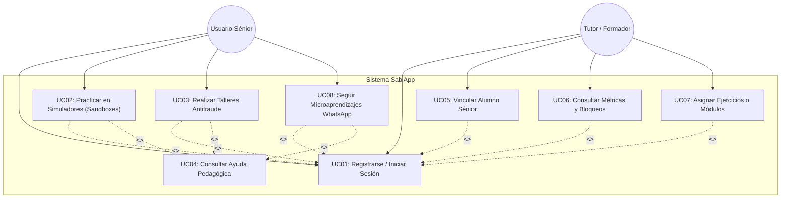

# 3.1 Planteamiento de Necesidades y Soluciones: SabiApp

* **Módulo:** Proyecto Intermodular (2.º DAW)
* **Sprint:** Sprint 1 y 2 (Descubrimiento, Definición, Arquitectura y Planificación)
* **Equipo de Desarrollo:** Minority Report (Juan Manuel Francisco Mendoza, Bakunin Sosa Álvarez, Irene Pascual Moreno)
* **Fecha:** Noviembre 2026

---

## Índice del Documento

- [1. Planteamiento del problema y necesidades detectadas](#1-planteamiento-del-problema-y-necesidades-detectadas)
  - [1.1 Diagnóstico del problema](#11-diagnóstico-del-problema)
  - [1.2 Contexto social, indicadores y justificación](#12-contexto-social-indicadores-y-justificación)
  - [1.3 Colectivos afectados y público objetivo](#13-colectivos-afectados-y-público-objetivo)
- [2. Análisis de alternativas y propuesta de solución](#2-análisis-de-alternativas-y-propuesta-de-solución)
  - [2.1 Análisis comparativo de alternativas de solución](#21-análisis-comparativo-de-alternativas-de-solución)
  - [2.2 Propuesta seleccionada: SabiApp](#22-propuesta-seleccionada-sabiapp)
  - [2.3 Estructura modular del sistema](#23-estructura-modular-del-sistema)
  - [2.4 Matriz de articulación funcional e integración modular](#24-matriz-de-articulación-funcional-e-integración-modular)
- [3. Aspectos innovadores y análisis comparativo](#3-aspectos-innovadores-y-análisis-comparativo)
  - [3.1 Estudio de la competencia (*Benchmarking*)](#31-estudio-de-la-competencia-benchmarking)
  - [3.2 Matriz comparativa de mercado](#32-matriz-comparativa-de-mercado)
  - [3.3 Factores diferenciales de innovación](#33-factores-diferenciales-de-innovación)
- [4. Viabilidad técnica, recursos y organización](#4-viabilidad-técnica-recursos-y-organización)
  - [4.1 Arquitectura del sistema y pila tecnológica](#41-arquitectura-del-sistema-y-pila-tecnológica)
  - [4.2 Recursos materiales e infraestructura de despliegue](#42-recursos-materiales-e-infraestructura-de-despliegue)
  - [4.3 Organización del equipo, roles y responsabilidades](#43-organización-del-equipo-roles-y-responsabilidades)
  - [4.4 Riesgos técnicos, limitaciones y medidas de mitigación](#44-riesgos-técnicos-limitaciones-y-medidas-de-mitigación)
- [5. Documentación de diseño y prototipado](#5-documentación-de-diseño-y-prototipado)
  - [5.1 Diagrama de Casos de Uso del sistema](#51-diagrama-de-casos-de-uso-del-sistema)
  - [5.2 Prototipos de interfaz de usuario (Wireframes)](#52-prototipos-de-interfaz-de-usuario-wireframes)
- [6. Presupuesto económico y plan de financiación](#6-presupuesto-económico-y-plan-de-financiación)
  - [6.1 Presupuesto de costes directos](#61-presupuesto-de-costes-directos)
  - [6.2 Coste del trabajo del equipo (no desembolsado)](#62-coste-del-trabajo-del-equipo-no-desembolsado)
  - [6.3 Estrategia de financiación](#63-estrategia-de-financiación)
  - [6.4 Viabilidad económica y punto de equilibrio (*Break-even*)](#64-viabilidad-económica-y-punto-de-equilibrio-break-even)
  - [6.5 Supuestos de cálculo y fuentes de mercado](#65-supuestos-de-cálculo-y-fuentes-de-mercado)
- [7. Metodología ágil, Epics y Criterios de Calidad (DoD)](#7-metodología-ágil-epics-y-criterios-de-calidad-dod)
  - [7.1 Marco ágil y definición de conceptos](#71-marco-ágil-y-definición-de-conceptos)
  - [7.2 Catálogo de Epics e Historias de Usuario (EP-01 a EP-08)](#72-catálogo-de-epics-e-historias-de-usuario-ep-01-a-ep-08)
  - [7.3 Definition of Done (DoD) global del proyecto](#73-definition-of-done-dod-global-del-proyecto)
  - [7.4 Planificación ágil y asignación por Sprints](#74-planificación-ágil-y-asignación-por-sprints)
- [8. Conclusiones y hoja de ruta](#8-conclusiones-y-hoja-de-ruta)
  - [8.1 Alcance del Producto Mínimo Viable (MVP)](#81-alcance-del-producto-mínimo-viable-mvp)
  - [8.2 Impacto formativo y social esperado](#82-impacto-formativo-y-social-esperado)
- [9. Fuentes de información, referencias normativas y mercado](#9-fuentes-de-información-referencias-normativas-y-mercado)
  - [9.1 Indicadores sociológicos y brecha digital](#91-indicadores-sociológicos-y-brecha-digital)
  - [9.2 Accesibilidad web, diseño ergonómico y legibilidad](#92-accesibilidad-web-diseño-ergonómico-y-legibilidad)
  - [9.3 Ciberseguridad, privacidad y marco regulatorio](#93-ciberseguridad-privacidad-y-marco-regulatorio)
  - [9.4 Infraestructura técnica, desarrollo y costes de mercado](#94-infraestructura-técnica-desarrollo-y-costes-de-mercado)

---

## 1. Planteamiento del problema y necesidades detectadas

### 1.1 Diagnóstico del problema

La digitalización obligatoria de servicios esenciales (atención primaria sanitaria, banca electrónica, citas administrativas y paquetería) impone el uso del smartphone como canal casi exclusivo. Para la población mayor de 55 y 65 años, este cambio representa una severa barrera funcional.

El análisis de interacción demuestra que el problema central no radica en la tenencia de equipamiento —la mayoría dispone de smartphone—, sino en la **falta de seguridad operativa y el miedo al error irreversible**:

1. **Parálisis por miedo al fallo operativo:** El usuario teme que una pulsación errónea borre información personal, inutilice el dispositivo o cause pérdidas económicas accidentales desde su cuenta bancaria.
2. **Dependencia continuada del entorno familiar:** Las gestiones se delegan en hijos o cuidadores, restando autonomía al mayor y sobrecargando a la familia como soporte técnico doméstico continuo.
3. **Vulnerabilidad ante ciberestafas (*phishing* y *smishing*):** Las campañas fraudulentas por SMS, correo o mensajería suplantando bancos o transportistas impactan con especial dureza ante la ausencia de pautas para identificar enlaces o remitentes falsos.

---

### 1.2 Contexto social, indicadores y justificación

* **Población conectada:** Datos del INE y ONTSI reflejan más de 11 millones de mayores conectados en España; más del 70% entre 55 y 74 años accede habitualmente a internet.
* **Uso limitado a operativas básicas:** La conectividad real se restringe a llamadas y mensajería elemental (WhatsApp). Los portales sanitarios o bancarios causan bloqueo por la complejidad de su interfaz y autenticación.
* **Cierre de canales presenciales:** La desaparición de sucursales bancarias de barrio, la retirada de cajeros y la reducción de ventanillas convierten la capacitación digital en un imperativo para el ejercicio de derechos básicos.
* **Ineficacia formativa actual:** Los cursos teóricos en aulas comunitarias sufren una rápida tasa de olvido al volver a casa sin acompañamiento, mientras que las apps comerciales ofrecen juegos de memoria abstractos sin utilidad práctica para la vida diaria.

**Justificación:** SabiApp nace para erradicar la exclusión social y financiera del colectivo sénior, aportando autonomía operativa y criterio de autodefensa frente al fraude digital.

---

### 1.3 Colectivos afectados y público objetivo

| Colectivo | Perfil | Necesidad prioritaria que atiende el proyecto |
| :--- | :--- | :--- |
| **Usuario final** | Personas de 55 a 75+ años. | Ganar seguridad operativa, practicar trámites a su ritmo e independizarse de la ayuda constante sin miedo a equivocarse. |
| **Familias y tutores** | Hijos y cuidadores (35 a 55 años). | Contar con una herramienta didáctica estructurada que descargue a la familia del rol de soporte reactivo continuo. |
| **Centros y administraciones** | Centros de mayores, residencias y servicios sociales. | Disponer de una plataforma evaluable para talleres con métricas de progreso de los usuarios. |

---

## 2. Análisis de alternativas y propuesta de solución

### 2.1 Análisis comparativo de alternativas de solución

| Alternativa | Descripción | Ventajas | Desventajas / Inconvenientes | Decisión |
| :--- | :--- | :--- | :--- | :---: |
| **A: Talleres presenciales con manuales en papel** | Cursos comunitarios clásicos con guías impresas. | • Trato humano directo.<br>• Útil para inicio desde cero absoluto. | • Rápido olvido sin práctica domiciliaria.<br>• Alto coste recurrente por alumno.<br>• Nula interactividad con pantallas móviles reales. | ❌ Descartada |
| **B: Hardware dedicado con software cerrado** | Tabletas simplificadas con software propietario preinstalado (modelo Bleta). | • Control del entorno técnico.<br>• Configuración simplificada de fábrica. | • Elevada barrera de coste (200–400 €).<br>• Estigmatización por uso de dispositivos especiales.<br>• No capacita en el móvil propio del usuario. | ❌ Descartada |
| **C: Plataforma web interactiva en simuladores seguros (*Sandboxes*) — SabiApp** | Web accesible desde cualquier dispositivo que replica fielmente trámites reales con datos ficticios. | • **Coste cero de equipamiento:** usa el móvil propio.<br>• **Inmunidad operativa total:** ensayo seguro sin consecuencias.<br>• **Acompañamiento:** panel de seguimiento para tutores.<br>• **Escalabilidad:** acceso inmediato vía navegador. | • Requiere conexión básica para carga inicial.<br>• Exige modelado riguroso de máquinas de estado en frontend. |  **Seleccionada** |

**Justificación de la elección:** La Alternativa C erradica el miedo al fallo permitiendo ensayar directamente en el smartphone del usuario con datos simulados, fijando memoria procedimental sin coste de hardware ni dependencia presencial constante.

---

### 2.2 Propuesta seleccionada: SabiApp

**SabiApp** es una plataforma web formativa orientada a la capacitación práctica mediante la simulación de tareas cotidianas reales en entornos inocuos (*sandboxes*), complementada con un panel de seguimiento para tutores y centros.

---

### 2.3 Estructura modular del sistema

* **Módulo 1: Simuladores de trámites (*Sandboxes*):** Reproduce con fidelidad los flujos de cita médica online (4 pasos guiados) y banca digital (consulta de saldo ficticio, movimientos y envíos Bizum simulados de 1 clic). Los datos son 100 % ficticios; el usuario puede repetir el proceso sin consecuencias reales.
* **Módulo 2: Taller de prevención de ciberestafas:** Entrenamiento reactivo frente a *phishing* y *smishing* mediante escenarios verosímiles de SMS y correos falsos. Incorpora retroalimentación pedagógica obligatoria con las pistas visuales que delatan el fraude.
* **Módulo 3: WhatsApp con microaprendizajes:** Itinerario de 8 lecciones cortas (3–5 min) organizadas en tres niveles (Básico, Intermedio y Avanzado). Recrea la interfaz de chat, audio, llamadas y grupos sin solicitar permisos reales de cámara, micrófono, galería ni agenda del dispositivo.
* **Módulo 4: Interfaz adaptada (UX Sénior) y Panel de tutores:** Interfaz de alta legibilidad (*Lexend* ≥ 18 px, contraste ≥ 4.5:1, botones ≥ 48 × 48 px, lenguaje llano sin tecnicismos) combinada con un dashboard analítico para tutores que reporta lecciones completadas, tasa de aciertos y pantallas de bloqueo frecuente.

---

### 2.4 Matriz de articulación funcional e integración modular

| Módulo funcional | Problema que resuelve | Aportación al usuario | Complejidad técnica (2.º DAW) |
| :--- | :--- | :--- | :--- |
| **Simuladores (*Sandboxes*)** | Miedo al error destructivo o financiero | Práctica segura sin consecuencias reales | Alta (Máquinas de estado y validaciones en cliente) |
| **Prevención de ciberestafas** | Vulnerabilidad ante ingeniería social | Criterio crítico y hábitos preventivos de alerta | Media (Gestión de eventos y capas pedagógicas) |
| **WhatsApp Microaprendizajes** | Uso limitado de la app cotidiana del sénior | Autonomía comunicativa y detección de fraude en chat | Media (Simulador de interfaz y motor de progresión) |
| **Interfaz adaptada + Panel** | Sobrecarga familiar y falta de seguimiento | Acompañamiento estructurado y alta accesibilidad | Media-Alta (Autenticación multi-rol y analítica) |

---

## 3. Aspectos innovadores y análisis comparativo

### 3.1 Estudio de la competencia (*Benchmarking*)

* **Apps de agilidad mental (Lumosity, CogniFit):** Ejercicios abstractos (memoria visual, series numéricas) sin aplicación a trámites cotidianos reales.
* **Plataformas de microaprendizaje generalistas (Duolingo):** Mecánica ágil eficaz, pero enfocada a idiomas y con penalizaciones punitivas (vidas y cronómetros) que generan ansiedad al usuario sénior.
* **Iniciativas tradicionales para mayores (Bleta, Canal Sénior):** Hardware dedicado de alto coste o charlas telemáticas pasivas (vídeos/conferencias), sin simulación interactiva sobre el terminal propio.

```
                    [ Diseñado específicamente para mayores ]
                                       ▲
                                       │          ★ SabiApp
                                       │        (Posicionamiento único)
                    CogniFit           │
                                       │     Canal Sénior
    Juegos mentales                    │                       Aprender a usar
    abstractos      ◄──────────────────┼─────────────────────► apps y trámites
    (memoria, etc.)                    │                       reales del día a día
                                       │
                    Lumosity           │     Duolingo
                                       ▼
                         [ Para todo tipo de público ]
```

---

### 3.2 Matriz comparativa de mercado

| Criterio diferencial | Lumosity / CogniFit | Duolingo | Bleta / Canal Sénior | SabiApp |
| :--- | :--- | :--- | :--- | :--- |
| **Público objetivo** | Población general | Estudiantes de idiomas | Mayores (modelo tradicional) | **Personas mayores (55 a 75+ años)** |
| **Objeto de aprendizaje** | Memoria abstracta | Gramática y vocabulario | Alfabetización teórica genérica | **Trámites y apps cotidianas reales** |
| **Dinámica didáctica** | Minijuegos repetitivos | Traducción y ejercicios | Sesiones en vídeo / Aulas | **Simulaciones prácticas guiadas paso a paso** |
| **Tratamiento del error** | Pérdida de puntuación | Vidas que se agotan | Dependencia del monitor | **Inocuo: repetición ilimitada sin castigos** |
| **Dispositivo de uso** | App móvil / Web | App móvil / Web | Tablet propietaria o aula | **Web adaptable en cualquier terminal propio** |

---

### 3.3 Factores diferenciales de innovación

1. **Innovación tecnológica (*Sandbox* aislado):** Práctica en flujos idénticos a los reales sin conexión a servicios externos, con inmunidad absoluta frente a cobros o borrado de datos.
2. **Innovación en diseño (UX Sénior nativa):** Tipografía *Lexend*, áreas táctiles ≥ 48 px, contraste verificado (WCAG 2.2 AA) y castellano llano sin tecnicismos en inglés.
3. **Innovación metodológica (Gamificación sin castigos):** Microlecciones de 3 a 5 minutos (*microlearning*) con refuerzo positivo, sin vidas, penalizaciones ni cuentas atrás.
4. **Modelo de distribución dual:** Modalidad gratuita para particulares con panel tutor, y licencias para centros de mayores y áreas sociales con analítica grupal.

---

## 4. Viabilidad técnica, recursos y organización

### 4.1 Arquitectura del sistema y pila tecnológica

SabiApp se implementa como **aplicación web *responsive*** accesible desde cualquier navegador estándar, evitando la barrera de descarga desde tiendas de apps (*Google Play* / *App Store*).

| Tecnología | Rol en el sistema | Justificación técnica |
| :--- | :--- | :--- |
| **HTML5 semántico, CSS3 y JS (ES6+)** | Frontend y motor de simulación. | Accesibilidad nativa para lectores de pantalla, maquetación fluida (Grid/Flexbox) y manipulación modular del DOM sin sobrecargar dispositivos modestos. |
| **PHP 8.x** | Backend y lógica de negocio. | Control de sesiones seguro, API REST, control de acceso por roles (Sénior/Tutor) y registro transaccional de progreso. |
| **MySQL 8.0** | Persistencia relacional (SGBD). | Almacenamiento estructurado de usuarios, lecciones parametrizadas y métricas con integridad referencial ACID. |
| **Docker & Docker Compose** | Contenedorización de entornos. | Homogeneización idéntica de servicios (servidor web, PHP-FPM y MySQL) en los puestos de los tres desarrolladores. |
| **Git y GitHub** | Control de versiones y flujo colaborativo. | Trabajo con ramas protegidas, integración mediante Pull Requests y revisiones cruzadas de código obligatorias. |
| **Figma** | Prototipado y sistema de diseño UI/UX. | Validación ergonómica de componentes y comprobación de contraste cromático previa a la programación. |
| **Lighthouse, WAVE y axe DevTools** | Auditoría continua de calidad. | Control sistemático de rendimiento, semántica web y cumplimiento riguroso de pautas WCAG 2.2 nivel AA. |

---

### 4.2 Recursos materiales e infraestructura de despliegue

* **Recursos materiales:** 3 portátiles personales de desarrollo (propiedad del equipo, coste cero) + dispositivos físicos de prueba (1 smartphone Android básico ≈ 150 € y 1 tablet Android básica ≈ 160 €) para evaluar rendimiento y ergonomía táctil real.
* **Infraestructura de despliegue:** Entorno local en Docker Compose (coste cero) y producción en VPS administrado con copias de seguridad automáticas (≈ 10 €/mes), dominio `.es` (7,25 € el primer año) y certificado TLS/HTTPS gratuito (Let's Encrypt).
* **Estrategia de respaldo:** Automatización periódica de volcados de base de datos (`mysqldump`).

---

### 4.3 Organización del equipo, roles y responsabilidades

| Integrante | Rol técnico principal | Responsabilidades técnicas | Responsabilidades de gestión |
| :--- | :--- | :--- | :--- |
| **Irene Pascual Moreno** | Backend y Lógica de Negocio | API REST en PHP 8, gestión de sesiones seguras, control de acceso por roles y validación de datos en servidor. | Gestión financiera, contabilidad y secretaría técnica de actas. |
| **Bakunin Sosa Álvarez** | Bases de Datos, DevOps e Infraestructura | Modelo relacional en MySQL 8, scripts de migración/seeding, Docker Compose y despliegue del VPS con HTTPS. | Compras de equipamiento de pruebas, gestión de servidores y gobernanza de Git. |
| **Juan Manuel Francisco Mendoza** | Frontend, UX y Accesibilidad | Maquetación web adaptable (HTML5/CSS3), módulos JS nativos, diseño en Figma y auditorías WCAG 2.2. | Coordinación del marco Scrum, relación con centros piloto y plan de marketing. |

**Plan de formación interna del equipo:** Accesibilidad web aplicada (WCAG 2.2 AA), seguridad en servidores (OWASP Top 10: PDO contra SQLi, tokens CSRF, hash Argon2id) y protocolos de prueba de usabilidad con usuarios mayores.

---

### 4.4 Riesgos técnicos, limitaciones y medidas de mitigación

| Riesgo identificado | Impacto | Medida de mitigación adoptada |
| :--- | :---: | :--- |
| **Heterogeneidad sensorial y motora** | Alto | Botones grandes (≥ 48 × 48 px), contraste certificado (≥ 4.5:1) y trámites acotados a un máximo de 4 pasos. |
| **Privacidad y cumplimiento normativo (RGPD)** | Alto | Minimización estricta: SabiApp nunca solicita credenciales bancarias ni sanitarias reales; todo opera con datos ficticios. |
| **Plazos ajustados en equipo de 3 desarrolladores** | Medio | Delimitación estricta al Producto Mínimo Viable (MVP) para los Sprints 2 y 3, priorizando el backlog esencial. |
| **Dispositivos antiguos y redes lentas** | Medio | Frontend en JavaScript nativo sin librerías pesadas, compresión WebP y carga diferida de pantallas. |
| **Mantenibilidad de los contenidos simulados** | Bajo | Parametrización en MySQL de textos y secuencias de lecciones, editable sin modificar código fuente. |
| **Complejidad excesiva en tecnologías emergentes** | Bajo | Descarte deliberado de IA generativa o reconocimiento por voz en fase MVP; foco en la robustez del motor interactivo. |

---

## 5. Documentación de diseño y prototipado

### 5.1 Diagrama de Casos de Uso del sistema



---

### 5.2 Prototipos de interfaz de usuario (Wireframes)

#### 5.2.1 Pantalla sénior: Simulador bancario (Envío de dinero)

```text
┌────────────────────────────────────────────────────────┐
│ SABIAPP                                    [?] Ayuda   │
├────────────────────────────────────────────────────────┤
│   [!] ENTORNO DE PRÁCTICA SEGURO                       │
│   (Sus cuentas y dinero real NO corren ningún riesgo)  │
├────────────────────────────────────────────────────────┤
│  PASO 1 DE 3: Elija a quién enviar el dinero           │
│  ┌──────────────────────────────────────────────────┐  │
│  │  [Contacto] María (Hija)           612 345 678   │  │
│  └──────────────────────────────────────────────────┘  │
│  ┌──────────────────────────────────────────────────┐  │
│  │  [Contacto] Juan (Nieto)           699 887 766   │  │
│  └──────────────────────────────────────────────────┘  │
│  ┌──────────────────────────────────────────────────┐  │
│  │  [+] Escribir un número nuevo                    │  │
│  └──────────────────────────────────────────────────┘  │
├────────────────────────────────────────────────────────┤
│  ┌────────────────────────┐  ┌──────────────────────┐  │
│  │  [<-] VOLVER AL MENÚ   │  │  CONTINUAR [->]      │  │
│  │  (Sin guardar)         │  │  (Paso siguiente)    │  │
│  └────────────────────────┘  └──────────────────────┘  │
└────────────────────────────────────────────────────────┘
```

#### 5.2.2 Pantalla sénior: Taller interactivo antifraude (SMS sospechoso)

```text
┌────────────────────────────────────────────────────────┐
│ SABIAPP - APRENDE A DETECTAR FRAUDES                   │
├────────────────────────────────────────────────────────┤
│  [SMS] Ha recibido el siguiente mensaje en su móvil:   │
│  ┌──────────────────────────────────────────────────┐  │
│  │ De: +34 600 000 999                              │  │
│  │ "CORREOS: Paquete retenido por falta de calle.   │  │
│  │  Pague 1,89 EUR aquí: correos-entrega-inc.com"   │  │
│  └──────────────────────────────────────────────────┘  │
│  ¿Qué debe hacer con este mensaje?                     │
│  ┌──────────────────────────────────────────────────┐  │
│  │  [X] 1. Pulsar el enlace para pagar los 1,89 EUR │  │
│  └──────────────────────────────────────────────────┘  │
│  ┌──────────────────────────────────────────────────┐  │
│  │  [V] 2. Borrar el mensaje y NO pulsar el enlace  │  │
│  └──────────────────────────────────────────────────┘  │
│  [*] Pista: Observe atentamente la dirección web (URL) │
└────────────────────────────────────────────────────────┘
```

#### 5.2.3 Pantalla tutor: Panel analítico de rendimiento y alertas

```text
┌────────────────────────────────────────────────────────────────────────┐
│  SABIAPP - PANEL DEL TUTOR                          [ Mi Cuenta (Tutor) ]│
├────────────────────────────────────────────────────────────────────────┤
│  Familiar supervisado: [ Carmen Mendoza (72 años) v ]  [ + Vincular ]  │
│  ┌───────────────────────┐ ┌───────────────────────┐ ┌───────────────┐ │
│  │ Módulos Completados   │ │ Tasa de Aciertos      │ │ Dificultad    │ │
│  │      6 de 8           │ │        85%            │ │ Pantalla      │ │
│  └───────────────────────┘ └───────────────────────┘ └───────────────┘ │
│  Detalle de Rendimiento y Bloqueos Recientes:                          │
│  ┌───────────────────────────┬─────────────┬─────────────────────────┐ │
│  │ Módulo de Simulación      │ Estado      │ Puntos de Atasco/Error  │ │
│  ├───────────────────────────┼─────────────┼─────────────────────────┤ │
│  │ Cita Médica (Salud)       │ Superado    │ Ninguno (Fluido)        │ │
│  │ Bizum Ficticio (Banca)    │ En progreso │ Duda al introducir PIN  │ │
│  │ Taller SMS (Ciberestafas) │ Superado    │ Requirió 2 intentos     │ │
│  └───────────────────────────┴─────────────┴─────────────────────────┘ │
│  Recomendación didáctica: Reforzar distinción entre Confirmar y        │
│  Cancelar en banca.                                                    │
└────────────────────────────────────────────────────────────────────────┘
```

---

## 6. Presupuesto económico y plan de financiación

Desarrollar el MVP funcional, lanzarlo y mantenerlo durante su primer año de servicio requiere un desembolso real de **893,49 €** (≈ 298 € por miembro del equipo).

### 6.1 Presupuesto de costes directos

Horizonte: MVP + 12 meses de servicio. Importes con IVA incluido:

| Categoría | Partida presupuestaria | Detalle de cálculo | Coste (€) |
| :--- | :--- | :--- | ---: |
| **Equipamiento de pruebas** | Smartphone Android básico para ensayos | 1 unidad (gama entrada, tipo Moto G / Xiaomi) | 150,00 € |
| | Tablet Android básica para ensayos | 1 unidad (Lenovo Tab M11 o equivalente) | 160,00 € |
| | Material fungible (guiones impresos, papel) | Sesiones de validación presencial con mayores | 25,00 € |
| **Infraestructura y hosting** | Servidor VPS administrado con backups | 10 €/mes × 12 meses | 120,00 € |
| | Dominio web `.es` | Registro anual primer año en OVH | 7,25 € |
| | Meriendas de cortesía en pruebas de usuario | 10 participantes sénior × 4 € | 40,00 € |
| **Marketing y difusión** | Impresión de 500 flyers A5 | MOO imprenta (difusión en centros de mayores) | 84,70 € |
| | Campaña de validación en Meta Ads | 50 €/mes × 3 meses (segmentado familias 35–55) | 150,00 € |
| | Desplazamientos a centros comunitarios | 10 visitas de validación y demos × 4 € | 40,00 € |
| | Herramientas (Figma, Git, Canva, Let's Encrypt) | Planes educativos o software libre | 0,00 € |
| | **Subtotal Costes Directos** | | **776,95 €** |
| **Contingencia (15 %)** | Margen para variaciones de hosting o CPC publicitario | 776,95 € × 0,15 | **116,54 €** |
| | **TOTAL PRESUPUESTO DESEMBOLSABLE** | | **893,49 €** |

> **Escenario mínimo:** Con dispositivos prestados por un centro colaborador (−310 €), el presupuesto baja a **537 €** (≈ 179 € por miembro).

---

### 6.2 Coste del trabajo del equipo (no desembolsado)

* **Dedicación semanal acordada (Team Charter):** 3 integrantes × 9 horas = 27 horas/semana.
* **Período de desarrollo:** 12 semanas formativas (324 horas totales de ingeniería).
* **Valoración a precio de mercado:** Con una tarifa estimada de desarrollador junior de 15 €/h, el valor de la mano de obra asciende a **4.860 €**. No sale de caja, pero refleja la inversión de trabajo técnico.

---

### 6.3 Estrategia de financiación

1. **Fase MVP:** Autofinanciación a partes iguales por los 3 integrantes (≈ 298 €/persona), sin deudas ni intermediarios.
2. **Apoyo en especie:** Convenios con centros comunitarios para la cesión de aulas de ensayo y participantes a cambio de talleres formativos gratuitos.
3. **Fase de explotación (Post-MVP):** Ingresos propios vía modelo *freemium*:
   * Suscripción familiar particular: 5 €/mes.
   * Licencia para centros de mayores y administraciones: 100 €/mes (incluye panel con analítica grupal y dinamización).

---

### 6.4 Viabilidad económica y punto de equilibrio (*Break-even*)

* **Costes fijos anuales de mantenimiento:** Servidor VPS con backups (120 €) + renovación de dominio (8,46 €) = **128,46 €/año**.
* **Comisiones de cobro (Stripe EEE: 1,5 % + 0,25 €):** En cobro mensual de 5 € la merma es del 6,5 % (0,33 €); en plan anual de 60 € la comisión baja al 1,9 % (1,15 €). Se incentivará el plan anual.
* **Punto de equilibrio para amortizar el desarrollo completo:**
  * **Con una sola licencia de centro institucional** (100 €/mes × 12 = 1.200 €/año) se amortiza el 100 % del presupuesto de lanzamiento y el primer año de hosting, generando beneficio neto.
  * **En canal familiar particular:** Bastan únicamente **16 suscriptores anuales** para recuperar íntegramente la inversión.

---

### 6.5 Supuestos de cálculo y fuentes de mercado

* **Dominio web `.es`:** OVHcloud (primer año 5,99 € + IVA = 7,25 €; renovación 6,99 € + IVA = 8,46 €).
* **Servidor VPS:** Tarifas de mercado Hetzner / OVH para VPS con backups automáticos (≈ 10 €/mes).
* **Hardware de pruebas:** Xataka Móvil (smartphones básicos 110–170 €) y Lenovo Tab M11 (≈ 160 €).
* **Flyers y publicidad:** MOO Imprenta (500 flyers A5, 84,70 €) y datos de Meta Ads Manager para España (CPC medio orientativo de 0,60 €).
* **RGPD:** Documentación estructurada mediante la herramienta oficial gratuita *Facilita RGPD* de la AEPD.

---

## 7. Metodología ágil, Epics y Criterios de Calidad (DoD)

### 7.1 Marco ágil y definición de conceptos

El desarrollo se gestiona con **Scrum** en tres Sprints de dos a tres semanas:
* Un **Epic** agrupa un conjunto coherente de funcionalidades que entregan un bloque de valor completo.
* Las **Historias de Usuario (US)** definen requisitos específicos desde la perspectiva del alumno sénior, tutor o desarrollador.
* El **Criterio de Finalización (*Definition of Done*)** fija las condiciones objetivas y verificables que aseguran que una tarea está terminada con calidad antes de considerarse entregada.

---

### 7.2 Catálogo de Epics e Historias de Usuario (EP-01 a EP-08)

#### EP-01 · Acceso y registro de usuarios
**Valor:** Registro, inicio de sesión, recuperación de contraseña y control de acceso seguro para los roles Alumno Sénior y Tutor, con redirección automática por rol.

| ID | El usuario necesita… | Se considera correcto cuando… |
| :--- | :--- | :--- |
| **US-01** | Registrarse en la plataforma | El formulario valida datos y la contraseña se almacena cifrada con hash Argon2id. |
| **US-02** | Iniciar sesión | Accede en menos de 2 s y el sistema le redirige a su zona correspondiente. |
| **US-03** | Cerrar sesión | La sesión se destruye por completo y vuelve a la pantalla de entrada. |
| **US-04** | Recuperar contraseña olvidada | Recibe un enlace por correo con caducidad máxima de 30 minutos. |
| **US-05** | Protección de zona por permisos | Rutas de tutores devuelven código 403 ante acceso no autorizado por rol. |

* **Criterio de finalización específico (EP-01):** Roles persistidos en BD; contraseñas nunca en texto plano; protección CSRF en formularios; navegable exclusivamente con teclado; probado en Chrome y Firefox.

---

#### EP-02 · Simulador de Cita Sanitaria (Sandbox)
**Valor:** Práctica guiada de solicitud de cita médica online en un entorno ficticio sin riesgo de alterar citas ni sistemas sanitarios reales.

| ID | El usuario necesita… | Se considera correcto cuando… |
| :--- | :--- | :--- |
| **US-06** | Entrar al simulador | Carga en menos de 3 s mostrando el primer paso del trámite. |
| **US-07** | Pedir cita guiada | Selección de especialidad, centro, fecha y hora en un máximo de 4 pasos. |
| **US-08** | Confirmar o cancelar cita | Pantalla de resumen antes de confirmar; cancelación posible en cualquier punto. |
| **US-09** | Ayuda contextual en cada paso | Botón (?) que despliega una explicación en lenguaje llano sin tecnicismos. |
| **US-10** | Reiniciar desde cero | Botón visible para volver al inicio sin penalización y con confirmación. |
| **US-11** | Consultar historial de ensayos | Registro del número de prácticas completadas y fecha de la última sesión. |

* **Criterio de finalización específico (EP-02):** Flujo completo sin fallos en máquina de estados; datos 100 % ficticios en MySQL; transiciones en < 1 s; soporte para lectores de pantalla; progreso registrado en BD y visible en el panel tutor.

---

#### EP-03 · Simulador de Bizum y Banca Online (Sandbox)
**Valor:** Práctica de operativa bancaria básica (saldo, movimientos, Bizum) en entorno simulado sin riesgo financiero real.

| ID | El usuario necesita… | Se considera correcto cuando… |
| :--- | :--- | :--- |
| **US-12** | Acceder al simulador bancario | Pantalla de bienvenida con nombre y saldo ficticio inicial. |
| **US-13** | Consultar saldo y movimientos | Muestra el saldo simulado y los últimos 5 movimientos inventados. |
| **US-14** | Realizar un Bizum simulado | Solicita teléfono ficticio, importe y concepto; confirmación en 1 clic. |
| **US-15** | Aviso de operación inusual | Si importe > 500 € (ficticio), alerta pedagógica con protocolo real de verificación. |
| **US-16** | Restablecer saldo inicial | Botón que restaura el saldo y movimientos a los datos semilla sin pérdidas. |
| **US-17** | Ver historial de transacciones | Contador accesible de transferencias y envíos ficticios practicados. |

* **Criterio de finalización específico (EP-03):** Cero conexiones con APIs bancarias reales (verificado en red); flujo de Bizum validado de principio a fin; alerta pedagógica evaluada con usuarios objetivo; botón de reinicio operativo.

---

#### EP-04 · Taller de Prevención de Estafas Digitales
**Valor:** Entrenamiento reactivo frente a *phishing* y *smishing* con retroalimentación formativa obligatoria para consolidar hábitos de alerta.

| ID | El usuario necesita… | Se considera correcto cuando… |
| :--- | :--- | :--- |
| **US-18** | Iniciar ejercicio de SMS sospechoso | SMS simulado con remitente anómalo y texto de urgencia (paquetería/banco). |
| **US-19** | Analizar el mensaje y decidir | Opciones: ignorar, bloquear o pulsar enlace (solo las dos primeras son seguras). |
| **US-20** | Retroalimentación inmediata | Pantalla explicativa con los indicios visuales que delatan el fraude. |
| **US-21** | Ejercicio de correo sospechoso | Correo falso con remitente falsificado y enlace malicioso visible. |
| **US-22** | Resumen de aciertos y fallos | Pantalla de resultados con porcentaje de acierto al concluir la tanda. |
| **US-23** | Reintentar casos fallados | Posibilidad de repetir exclusivamente los escenarios resueltos de forma errónea. |

* **Criterio de finalización específico (EP-04):** Mínimo 4 escenarios parametrizados en BD (2 SMS y 2 emails); retroalimentación ineludible (botón bloqueado hasta lectura o 5 s); 100 % funcional sin internet externa; resultados visibles para el tutor.

---

#### EP-05 · Panel de Seguimiento para Tutores
**Valor:** Dashboard analítico para familiares o formadores que reporta el avance real del alumno sénior y localiza las pantallas de bloqueo.

| ID | El usuario necesita… | Se considera correcto cuando… |
| :--- | :--- | :--- |
| **US-24** | Ver lista de alumnos asignados | Listado con nombre, fecha de último acceso y porcentaje global de avance. |
| **US-25** | Detalle de avance por módulo | Estado (completado / en curso / pendiente) e intentos por cada simulador. |
| **US-26** | Identificar pantallas de bloqueo | Señalización del paso concreto donde el alumno abandonó con mayor frecuencia. |
| **US-27** | Vincular a un alumno nuevo | Asignación por correo electrónico con notificación de vinculación. |
| **US-28** | Desvincular a un alumno | Eliminación de la relación sin destruir los datos históricos de progreso. |

* **Criterio de finalización específico (EP-05):** Acceso restringido exclusivamente a rol tutor (HTTP 403 al sénior); métricas sincronizadas con máx. 5 min de desfase; comprobación cruzada correcta con la BD; interfaz usable en tablet (≥ 768 px).

---

#### EP-06 · Diseño adaptado para personas mayores (UX Sénior)
**Valor:** Sistema de diseño accesible que garantiza legibilidad, confort visual y navegación autónoma en usuarios de 55 o más años.

| ID | El usuario necesita… | Se considera correcto cuando… |
| :--- | :--- | :--- |
| **US-29** | Textos de alta legibilidad | Tipografía *Lexend* a mínimo 18 px en body y contraste verificado ≥ 4.5:1. |
| **US-30** | Botones táctiles amplios | Todos los elementos pulsables miden al menos 48 × 48 px. |
| **US-31** | Lenguaje llano y cotidiano | Erradicación total de anglicismos y tecnicismos en la interfaz sénior. |
| **US-32** | Adaptabilidad a pantallas | Diseño responsive sin scroll horizontal desde 360 px de ancho. |
| **US-33** | Ajuste de tamaño de fuente | Selector entre tamaño normal y grande, guardando la preferencia en sesión. |

* **Criterio de finalización específico (EP-06):** Sistema de componentes definido en Figma antes de maquetar; cero errores críticos en auditorías automáticas (WAVE / axe DevTools); contrastes verificados; pruebas de usabilidad con mayores documentadas en backlog.

---

#### EP-07 · Infraestructura, DevOps y Despliegue
**Valor:** Entorno de desarrollo local dockerizado idéntico para los 3 miembros, control ordenado de versiones en GitHub y despliegue seguro con HTTPS.

| ID | El usuario/equipo necesita… | Se considera correcto cuando… |
| :--- | :--- | :--- |
| **US-34** | Levantar entorno local unificado | Comando `docker compose up -d` arranca Nginx, PHP-FPM y MySQL en los 3 equipos. |
| **US-35** | Migraciones y datos semilla | Scripts SQL de esquema y seeding ejecutables limpiamente en el contenedor. |
| **US-36** | Despliegue guiado en producción | Documentación de despliegue reproducible en VPS en menos de 30 minutos. |
| **US-37** | Gestión de versiones protegida | Ramas `main` y `dev` con protección en GitHub; prohibido el push directo. |
| **US-38** | Conexión segura en internet | Acceso web mediante HTTPS con certificado TLS válido; redirección 301 desde HTTP. |

* **Criterio de finalización específico (EP-07):** Dockerfile y docker-compose verificados individualmente; fichero `.env.example` completo sin secretos en repositorio; backups automáticos de MySQL configurados y verificados con una restauración exitosa.

---

#### EP-08 · Módulo de WhatsApp con microaprendizajes
**Valor:** Itinerario de 8 lecciones cortas (3–5 min) en tres niveles para capacitar en el uso seguro y autónomo de WhatsApp mediante un simulador que no accede a datos reales.

| Nivel | ID | Lección procedimental | Duración |
| :--- | :--- | :--- | :---: |
| 🟢 Básico | **ML-01** | Leer y escribir un mensaje de texto | 3 min |
| 🟢 Básico | **ML-02** | Enviar un mensaje de voz (audio simulado) | 3 min |
| 🟢 Básico | **ML-03** | Enviar y visualizar una fotografía de galería simulada | 4 min |
| 🟡 Intermedio | **ML-04** | Realizar una llamada de voz simulada | 3 min |
| 🟡 Intermedio | **ML-05** | Realizar una videollamada con cámara ficticia | 4 min |
| 🟡 Intermedio | **ML-06** | Gestionar grupos: silenciar notificaciones y salir | 5 min |
| 🔴 Avanzado | **ML-07** | Reconocer un mensaje fraudulento recibido por chat | 5 min |
| 🔴 Avanzado | **ML-08** | Bloquear a un contacto desconocido o sospechoso | 4 min |

| ID | El usuario necesita… | Se considera correcto cuando… |
| :--- | :--- | :--- |
| **US-39** | Acceso desde el menú principal | Icono reconocible que carga el itinerario en menos de 2 s. |
| **US-40** | Ver itinerario y avance | Lista con estado visual: bloqueado, disponible o completado. |
| **US-41** | Simulación de chat de texto | Interfaz que guía el tecleo y envío simulado con guía superpuesta. |
| **US-42** | Simulación de nota de voz | Animación de grabación sin acceso al micrófono real del terminal. |
| **US-43** | Simulación de envío de fotos | Selección desde una galería interna de fotos ficticias integradas. |
| **US-44** | Simulación de llamada de voz | Pantalla interactiva con botones para responder, silenciar y colgar. |
| **US-45** | Simulación de videollamada | Interfaz con imagen propia ficticia en miniatura y controles de llamada. |
| **US-46** | Silenciar y salir de grupos | Secuencia guiada en menú de grupo simulado con confirmación. |
| **US-47** | Identificar estafa por chat | Ejercicio con enlaces maliciosos; retroalimentación obligatoria. |
| **US-48** | Bloqueo de contactos | Pasos guiados desde el perfil de chat ficticio para bloquearlo. |
| **US-49** | Insignias al completar nivel | Pantalla de felicitación e insignia visual persistida en BD. |
| **US-50** | Reflejo en panel de tutores | El tutor visualiza lecciones completadas y porcentaje de avance. |

* **Criterio de finalización específico (EP-08):** 8 microaprendizajes accesibles con desbloqueo progresivo; cero peticiones de permisos reales (micrófono, cámara, contactos o fotos); duración máxima de 5 min por lección; insignias persistidas tras logout.

---

### 7.3 Definition of Done (DoD) global del proyecto

> [!IMPORTANT]
> Ninguna tarea, historia de usuario o Epic se considera terminada ni apta para entrega sin cumplir la totalidad de los siguientes criterios:

* **Desarrollo y Código:** Compila y ejecuta sin errores en Docker; integrado en `main` exclusivamente vía Pull Request aprobada por otro miembro; sin contraseñas ni secretos en el repositorio; código limpio y comentado.
* **Calidad Funcional:** Criterios de aceptación verificados con pruebas manuales documentadas; sin regresiones en funcionalidades previas; errores gestionados con mensajes claros para mayores (nunca trazas del servidor); sin datos de prueba en producción.
* **Accesibilidad y UX:** Sin errores críticos en auditorías automáticas (axe DevTools / WAVE); objetivos táctiles ≥ 48 × 48 px; contraste verificado ≥ 4.5:1; responsive y navegable por teclado.
* **Seguridad:** Consultas con sentencias preparadas mediante PDO (prevención de SQLi); protección CSRF en todos los formularios; rutas restringidas protegidas por sesión y rol en servidor; sin cabeceras que revelen versiones de software.
* **Entrega Ágil:** Tarea movida a *Done* en el tablero Kanban; rama de trabajo eliminada tras fusionar; incremento preparado para demo directa en la reunión de revisión de Sprint.

---

### 7.4 Planificación ágil y asignación por Sprints

| Epic | Módulo funcional | Sprint | Responsable principal | Historias de usuario |
| :--- | :--- | :---: | :--- | :---: |
| **EP-01 · Acceso y registro** | Transversal | Sprint 2 | Irene Pascual Moreno | US-01 a US-05 |
| **EP-02 · Cita Sanitaria** | 2.3 Sandboxes (Salud) | Sprint 2–3 | Juan Manuel Francisco Mendoza | US-06 a US-11 |
| **EP-03 · Bizum / Banca** | 2.3 Sandboxes (Banca) | Sprint 2–3 | Bakunin Sosa Álvarez | US-12 a US-17 |
| **EP-04 · Taller Ciberestafas** | 2.3 Prevención antifraude | Sprint 3 | Irene Pascual Moreno | US-18 a US-23 |
| **EP-05 · Panel de Tutores** | 2.3 Dashboard analítico | Sprint 3 | Irene Pascual Moreno | US-24 a US-28 |
| **EP-06 · Diseño adaptado (UX)** | 2.3 Sistema accesible | Sprint 2 (inicio) | Juan Manuel Francisco Mendoza | US-29 a US-33 |
| **EP-07 · DevOps e Infraestructura** | 4.1 y 4.2 Arquitectura | Sprint 1–2 | Bakunin Sosa Álvarez | US-34 a US-38 |
| **EP-08 · Microaprendizajes WhatsApp** | 2.3 Mensajería guiada | Sprint 3 | Juan Manuel Francisco Mendoza | US-39 a US-50 |

---

## 8. Conclusiones y hoja de ruta

### 8.1 Alcance del Producto Mínimo Viable (MVP)

1. Autenticación multi-rol (Alumno Sénior y Tutor/Formador) con control de acceso.
2. Dos simuladores operativos prioritarios: **Cita Sanitaria** y **Operativa Bizum simulada**.
3. Taller interactivo de **entrenamiento contra *phishing* y *smishing***.
4. **Módulo de WhatsApp** con 8 microaprendizajes en tres niveles.
5. **Panel analítico de seguimiento** para tutores con reporte de atascos.
6. Infraestructura contenerizada desplegada en VPS con certificado TLS/HTTPS.

---

### 8.2 Impacto formativo y social esperado

* **Autonomía individual:** Recuperación de la confianza en trámites cotidianos y reducción de la brecha digital involuntaria.
* **Prevención de ciberdelincuencia:** Disminución del éxito de ataques de ingeniería social mediante entrenamiento seguro y reflexivo.
* **Descarga familiar:** Conversión del soporte técnico reactivo doméstico en un acompañamiento didáctico positivo.

---

## 9. Fuentes de información, referencias normativas y mercado

Las siguientes referencias bibliográficas, técnicas y normativas se encuentran estructuradas conforme a los estándares de citación de la **American Psychological Association (APA 7.ª edición)**:

### 9.1 Indicadores sociológicos y brecha digital

Banco de España. (2023). *Informe sobre infraestructuras financieras y evolución de oficinas bancarias en España: Accesibilidad al efectivo y servicios bancarios presenciales*. Departamento de Conducta de Entidades. https://www.bde.es/

Instituto Nacional de Estadística. (2024). *Encuesta sobre equipamiento y uso de tecnologías de información y comunicación en los hogares (TIC-H 2024)*. Notas de Prensa INE. https://www.ine.es/prensa/tich_2024.pdf

Observatorio Nacional de Tecnología y Sociedad. (2023). *Competencias digitales en el colectivo sénior en España: Uso de canales telemáticos públicos y privados*. Ministerio para la Transformación Digital y de la Función Pública. https://www.ontsi.es/

Unión Democrática de Pensionistas y Jubilados de España. (2023). *Barómetro de Mayores UDP: Exclusión financiera y brecha digital en personas mayores de 65 años*. Mayores UDP. https://www.mayoresudp.org/

### 9.2 Accesibilidad web, diseño ergonómico y legibilidad

Apple Inc. (2024). *Human interface guidelines: Designing for accessibility and touch targets*. Apple Developer Documentation. https://developer.apple.com/design/human-interface-guidelines/accessibility

Google. (2023). *Material Design 3: Accessibility standards and touch target size*. Google Design Guidelines. https://m3.material.io/foundations/accessible-design/accessibility-basics

Jockin, T. (2020). *Lexend: Decoupling reading fluency from reading comprehension through individualized typography*. Google Fonts Insights. https://www.lexend.com/

World Wide Web Consortium. (2020). *Older users and web accessibility: Meeting the needs of ageing web users*. W3C Web Accessibility Initiative (WAI). https://www.w3.org/WAI/older-users/

World Wide Web Consortium. (2023). *Web content accessibility guidelines (WCAG) 2.2* (W3C Recommendation 05 October 2023). W3C. https://www.w3.org/TR/WCAG22/

### 9.3 Ciberseguridad, privacidad y marco regulatorio

Agencia Española de Protección de Datos. (2023). *Guía de protección de datos por defecto y herramienta de evaluación Facilita RGPD*. AEPD. https://www.aepd.es/es/guias-y-herramientas/herramientas/facilita-rgpd

España. (2018). Ley Orgánica 3/2018, de 5 de diciembre, de Protección de Datos Personales y garantía de los derechos digitales. *Boletín Oficial del Estado*, (294), 119788-119857. https://www.boe.es/eli/es/lo/2018/12/05/3

Instituto Nacional de Ciberseguridad. (2024). *Guía práctica de ciberseguridad para ciudadanos y personas mayores: Prevención de ingeniería social, phishing y smishing*. INCIBE - Oficina de Seguridad del Internauta (OSI). https://www.incibe.es/ciudadania

OWASP Foundation. (2021). *OWASP Top 10: 2021 Web application security risks*. Open Web Application Security Project. https://owasp.org/Top10/

Unión Europea. (2016). Reglamento (UE) 2016/679 del Parlamento Europeo y del Consejo, de 27 de abril de 2016, relativo a la protección de las personas físicas en lo que respecta al tratamiento de datos personales y a la libre circulación de estos datos (Reglamento General de Protección de Datos). *Diario Oficial de la Unión Europea*, L 119, 1-88. http://data.europa.eu/eli/reg/2016/679/oj

### 9.4 Infraestructura técnica, desarrollo y costes de mercado

Docker Inc. (2026). *Docker Compose file reference and containerized environments* (Versión 2.2x). Docker Documentation. https://docs.docker.com/compose/

Hetzner Online GmbH. (2026). *Cloud VPS hosting specifications, benchmark performance and backup policies*. Hetzner Docs. https://docs.hetzner.com/

Meta for Business. (2026). *Métricas de rendimiento publicitario y costes por clic en campañas segmentadas en España*. Meta Ads Help Center. https://www.facebook.com/business/ads

MOO Print Ltd. (2026). *Especificaciones técnicas y tarifas de impresión para folletos y flyers A5*. MOO Europe. https://www.moo.com/es/flyers/a5

Oracle Corporation. (2026). *MySQL 8.0 reference manual: Relational database management system*. Oracle Help Center. https://dev.mysql.com/doc/refman/8.0/en/

OVHcloud. (2026). *Tarifas oficiales de registro, transferencia y renovación de dominios de primer nivel .es*. OVH Hispano. https://www.ovhcloud.com/es-es/domains/tld/es/

Stripe Inc. (2026). *Cuadro de comisiones aplicables a transacciones y pagos electrónicos en el Espacio Económico Europeo*. Stripe Pricing. https://stripe.com/es/pricing

The PHP Group. (2026). *PHP 8 documentation and language reference manual*. PHP.net. https://www.php.net/manual/es/
