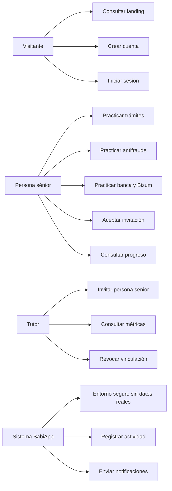

# Plan de Ejecución — Sprint 0

**Proyecto:** SabiApp  
**Equipo:** Minority Report  
**Fecha de planificación:** Noviembre de 2026  
**Herramienta de gestión:** GitHub Projects / Issues  

Este documento contiene la planificación suficiente para comenzar el Sprint 1 sin cerrar en detalle soluciones que deberán evolucionar con el aprendizaje técnico y el feedback.

## 1. Objetivo del Sprint 0

Establecer el alcance global, priorizar Epics e historias de usuario, anticipar riesgos y dejar preparado el entorno de trabajo para iniciar el desarrollo del MVP.

## 2. Roadmap de Epics

| Epic | Alcance | Sprint previsto | Prioridad |
| :--- | :--- | :---: | :---: |
| **EP-01** Arquitectura base e infraestructura | Docker, VPS, HTTPS, landing, repositorio, MySQL y migraciones | 1 | Alta |
| **EP-02** Diseño y UX sénior | Sistema visual, componentes accesibles y diseño responsive | 2 | Alta |
| **EP-03** Simulador de cita médica | Flujo guiado de cuatro pasos con datos ficticios | 3 | Alta |
| **EP-04** Taller antifraude | Cuatro escenarios interactivos de SMS y correo | 4 | Alta |
| **EP-05** Simulador de banca y Bizum | Práctica segura con saldo y operaciones ficticias | 5 | Alta |
| **EP-06** Microaprendizaje de WhatsApp | Lecciones cortas y desbloqueo progresivo | Post-MVP | Media |
| **EP-07** Acceso y autenticación | Registro, login, recuperación y roles | 6 | Alta |
| **EP-08** Panel del tutor y vinculación | Invitaciones, métricas, aceptación y revocación | 7 | Alta |

### Product Backlog resumido

Las 52 historias de usuario existentes se estiman con T-Shirt Sizing en el tablero. El Sprint 1 debe seleccionar las historias `US-34` a `US-38`, pertenecientes a EP-01.

| Referencia | Epic | Tamaño inicial | Estado |
| :--- | :--- | :---: | :--- |
| US-34 a US-38 | EP-01 Arquitectura e infraestructura | M / L | Ready para Sprint 1 |
| US-29 a US-33 | EP-02 UX y accesibilidad | M | Backlog refinado |
| US-06 a US-17 | EP-03 y EP-05 Simuladores | M / L | Backlog |
| US-18 a US-23 | EP-04 Antifraude | M | Backlog |
| US-01 a US-05 | EP-07 Acceso y autenticación | M / L | Backlog |
| US-24 a US-28, US-51 y US-52 | EP-08 Panel del tutor | M / L | Backlog |
| US-39 a US-50 | EP-06 WhatsApp | S / M | Post-MVP |

## 3. Diagrama general de casos de uso

## 4. Matriz general de riesgos

| ID | Riesgo | Categoría | Prob. | Impacto | Prevención | Contingencia | Responsable |
| :---: | :--- | :--- | :---: | :---: | :--- | :--- | :--- |
| R1 | Retraso o fallo del VPS/HTTPS | Técnico/externo | Media | Alta | Proveedor documentado, acceso anticipado y PoC | Usar entorno local Docker y reprogramar despliegue | Bakunin |
| R2 | Baja disponibilidad de un integrante | Humano | Media | Alta | Revisión cruzada y documentación de decisiones | Redistribuir tareas sin ampliar el sprint | Equipo |
| R3 | La tecnología seleccionada no está dominada | Técnico/humano | Media | Alta | Talleres cortos y prototipos de Laravel/React | Simplificar alcance y conservar stack aprobado | Equipo técnico |
| R4 | Diferencias entre equipos de desarrollo | Técnico | Media | Media | Docker Compose, `.env.example` y versiones fijadas | Reconstruir contenedor y documentar pasos | Bakunin |
| R5 | Datos personales o contraseñas expuestos | Seguridad | Baja | Muy alta | No usar datos reales, Argon2id, variables de entorno y revisión | Revocar credenciales y registrar incidencia | Irene |
| R6 | Acceso denegado a personas mayores o centros | Validación | Media | Alta | Identificar centro antes del Sprint 7 y preparar protocolo | Realizar validación con participantes voluntarios | Juan Manuel |
| R7 | La seguridad o el presupuesto impiden cumplir el MVP | Financiero/seguridad | Baja | Alta | Presupuesto cerrado y herramientas gratuitas donde sea posible | Eliminar servicios cancelables y reutilizar recursos locales | Equipo |

### Criterio de prioridad de riesgos

Se calcula una puntuación cualitativa de `probabilidad × impacto`: muy alto y alto se revisan al principio de cada sprint; medio se controla en la revisión semanal; bajo se mantiene en seguimiento.

## 5. Recursos y permisos

### Recursos humanos

- Tres desarrolladores con responsabilidad técnica transversal.
- Un integrante de cada área revisará el trabajo de otro compañero.
- El Product Owner describe y prioriza las HU de cada Sprint; las tareas técnicas las realiza el equipo de desarrollo.

### Recursos materiales

- GitHub, GitHub Projects, Docker/Docker Compose y un VPS.
- Laravel, React, Tailwind, MySQL, Nginx y dominio/HTTPS.
- GitHub Education, Figma, WAVE/axe y herramientas de línea de comandos.
- Smartphone Android y tablet Android como dispositivos reales de prueba.

### Permisos y autorizaciones

- Credenciales propias del VPS y del dominio.
- Acceso autorizado a centros para las pruebas presenciales.
- Consentimiento y datos mínimos de participantes, sin datos bancarios reales.
- Uso de datos ficticios y entornos simulados en el desarrollo.

## 6. Objetivo seleccionado para el Sprint 1

**EP-01 — Arquitectura base e infraestructura**

Al finalizar el Sprint 1 el equipo deberá demostrar:

1. Docker Compose ejecutable en los tres equipos.
2. Landing inicial accesible y base visual adaptada.
3. API Laravel y MySQL con migraciones y datos semilla.
4. VPS, HTTPS y copias básicas probadas.
5. Reglas de ramas, Pull Requests y documentación actualizada.
