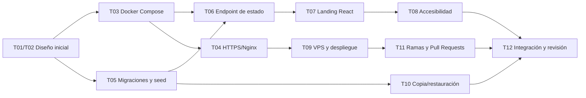
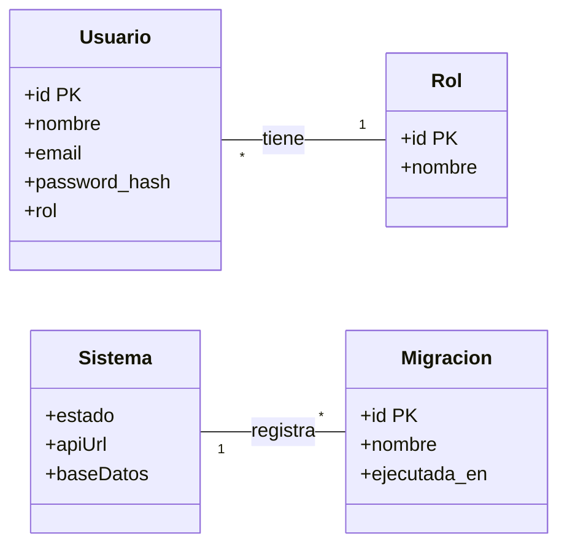
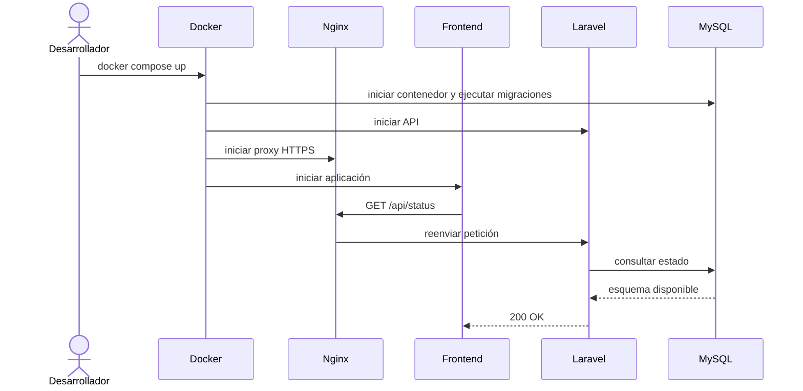

# Plan de Ejecución — Sprint 1

**Proyecto:** SabiApp  
**Epic:** EP-01 Arquitectura base e infraestructura  
**Duración:** 1 semana  
**Objetivo:** disponer de una base técnica reproducible, segura y demostrable para continuar con el MVP.

## 1. Historias seleccionadas

| HU | Historia de usuario | Criterios de aceptación | Tamaño |
| :--- | :--- | :--- | :---: |
| US-34 | Como desarrollador, quiero ejecutar el proyecto con Docker Compose, para obtener el mismo entorno en todos los equipos. | `docker compose up` arranca sin errores; frontend, backend y base de datos comparten red; existe `.env.example`. | L |
| US-35 | Como desarrollador, quiero una base MySQL versionada, para crear y reproducir los datos iniciales. | Hay migraciones y datos semilla ficticios; el esquema puede reconstruirse desde cero. | M |
| US-36 | Como visitante, quiero consultar una landing inicial, para comprender qué ofrece SabiApp. | Existe una pantalla inicial responsive con navegación clara y texto alternativo para imágenes. | M |
| US-37 | Como equipo técnico, quiero publicar el entorno con HTTPS, para validar la aplicación de forma segura. | HTTPS responde 200 o 301; no hay fallos de certificado ni secretos versionados. | L |
| US-38 | Como equipo técnico, quiero copias y restauración probadas, para prevenir pérdidas durante el desarrollo. | Se realiza una copia y una restauración documentada sin exponer datos reales. | M |

## 2. Descomposición en tareas

| ID | Tarea técnica | HU | Responsable | Estimación |
| :--- | :--- | :--- | :--- | :---: |
| T01 | Crear diagrama de clases inicial de Usuario, Rol y Sistema | US-35 | Irene | 2 h |
| T02 | Crear diagrama de secuencia de arranque y acceso a MySQL | US-34, US-35 | Irene / Bakunin | 2 h |
| T03 | Configurar Docker Compose de frontend, backend y base de datos | US-34 | Bakunin | 6 h |
| T04 | Crear Nginx, certificados locales y reglas HTTPS | US-37 | Bakunin | 4 h |
| T05 | Añadir migraciones y datos semilla ficticios | US-35 | Irene | 5 h |
| T06 | Crear endpoint de estado y comprobar acceso desde frontend | US-34, US-35 | Irene | 3 h |
| T07 | Implementar landing React responsive | US-36 | Juan Manuel | 6 h |
| T08 | Aplicar tipografía, contraste y navegación por teclado | US-36 | Juan Manuel | 4 h |
| T09 | Configurar VPS, dominio y despliegue inicial | US-37 | Bakunin | 5 h |
| T10 | Crear guion y ejecutar copia/restauración | US-38 | Bakunin / Irene | 3 h |
| T11 | Configurar ramas protegidas y plantilla de Pull Request | Todas | Equipo | 2 h |
| T12 | Probar el flujo completo, revisar código y actualizar documentación | Todas | Equipo | 4 h |

## 3. Secuenciación y dependencias

Tareas que pueden ejecutarse en paralelo:

- Diseño UML y Docker Compose.
- Migraciones MySQL y maqueta de landing.
- Copia/restauración y configuración de ramas.

Tareas dependientes:

- El endpoint de estado necesita el contenedor y el esquema.
- El despliegue HTTPS necesita la configuración de Docker/Nginx.
- La integración final debe esperar a landing, endpoint y VPS.

## 4. Recursos y asignación

| Responsable | Disponibilidad inicial | Entrega principal |
| :--- | :--- | :--- |
| Irene | Backend y BBDD | UML, migraciones, seed y endpoint |
| Bakunin | DevOps e infraestructura | Docker, HTTPS, VPS y recuperación |
| Juan Manuel | Frontend y accesibilidad | Landing, diseño, navegación y documentación visual |

La carga debe mantenerse equilibrada; si aparece una incapacidad temporal, el equipo redistribuye las tareas sin cambiar el objetivo ni las fechas límite.

## 5. Diagramas UML just-in-time

### Diagrama de clases inicial

### Diagrama de secuencia: arranque y comprobación

## 6. Plan de calidad y seguridad del Sprint

### Indicadores de calidad

- `docker compose up` funcional en los tres equipos.
- Landing sin errores críticos de WAVE/axe.
- Contraste ≥ 4,5:1, teclado operativo y distribución mínima a 320 px.
- Migraciones y datos semilla ejecutables desde cero.
- HTTPS operativo y copias restauradas con éxito.
- Toda tarea integrada mediante rama corta y Pull Request aprobada por otro miembro.
- Sin errores o advertencias críticas en consola.

### Pruebas mínimas

| Tipo | Evidencia |
| :--- | :--- |
| Arranque | Captura o log de los contenedores activos en cada equipo |
| Migración | Base creada desde cero y datos semilla ficticios visibles |
| HTTP/HTTPS | Respuesta documentada de la landing y `/api/status` |
| Accesibilidad | Informe WAVE/axe y prueba manual de teclado |
| Recuperación | Copia realizada y restauración comprobada |
| Revisión | PR aprobada y comentarios resueltos |

### Seguridad

- No se versionan contraseñas, certificados privados ni datos reales.
- Los secretos se almacenan en variables de entorno y se entrega `.env.example`.
- Las contraseñas futuras se gestionarán con Argon2id.
- Las consultas usan ORM/consultas preparadas.
- CSRF y permisos se integrarán desde el diseño inicial.
- Los datos de prueba son ficticios y no representan usuarios reales.

### Green IT

- Imágenes mínimas y optimizadas.
- Contenedores con versiones fijadas.
- Consultas sencillas y sin llamadas innecesarias.
- VPS con almacenamiento limitado al mínimo necesario.

## 7. Definition of Done del Sprint

Una tarea estará terminada únicamente si cumple:

1. Funcionalidad completa y verificable.
2. Código legible, revisado por una segunda persona y refactorizado si procede.
3. Pruebas ejecutadas y evidencia guardada en el repositorio o tablero.
4. No existen secretos, datos reales ni errores críticos.
5. El trabajo está integrado en `develop` mediante Pull Request.
6. README, documentación técnica y decisiones quedan actualizadas.
7. El incremento puede demostrarse al finalizar el Sprint.
